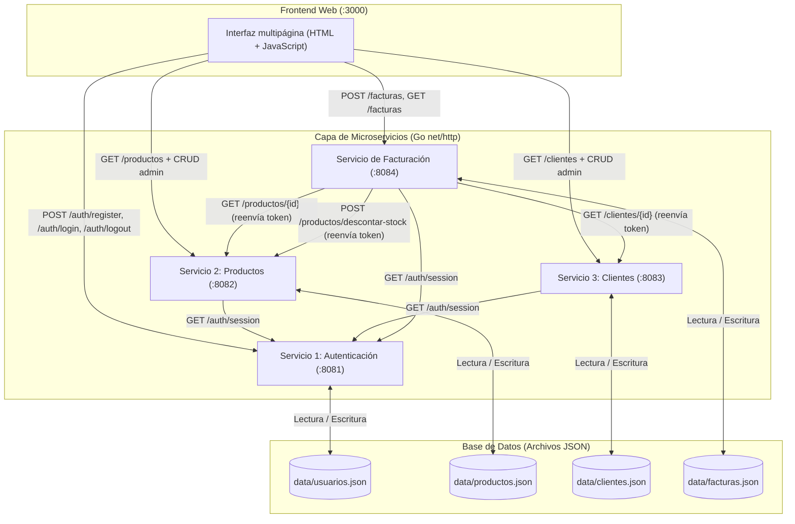

# Documento Técnico: Proyecto de Programación Avanzada 2026_2

**Integrantes:**

- [INTEGRANTE 1]
- [INTEGRANTE 2]

---

## (a) Arquitectura del Sistema

El sistema implementa una arquitectura orientada a microservicios independientes desarrollada en Go utilizando exclusivamente la biblioteca estándar `net/http` para la comunicación REST y archivos JSON como almacén de datos persistente.

### Componentes

1. **Frontend (HTML + JavaScript):** interfaz multipágina desacoplada servida por un servidor web estático (`:3000`). El administrador dispone de catálogo de productos con CRUD, directorio de clientes con CRUD, emisión de facturas con control de stock e historial. El cliente solo accede a sus propias facturas, con detalle, modal JSON, impresión y descarga en PDF.
2. **Servicio 1 — Autenticación (`:8081`):** registro con rol (`admin`/`cliente`), login con **token opaco de sesión**, logout y validación de sesión. En el rol `cliente`, el nombre no se pide: Auth consulta el directorio de Clientes y copia el nombre que el administrador registró. Las sesiones viven en memoria con un TTL configurable (`8h` por defecto). Las contraseñas se almacenan en texto plano como simplificación académica. Persiste en `data/usuarios.json`.
3. **Servicio 2 — Productos (`:8082`):** CRUD del catálogo (precios y stock) y descuento atómico de stock solicitado por Facturación. Todas las rutas exigen rol `admin`. Persiste en `data/productos.json`.
4. **Servicio 3 — Clientes (`:8083`):** CRUD de clientes (nombre, cédula, correo, dirección) con unicidad atómica de email y cédula. Todas las rutas exigen rol `admin`, salvo la consulta interna por email que usa Auth para validar el registro del cliente. Persiste en `data/clientes.json`.
5. **Servicio de Facturación (`:8084`):** microservicio orquestador que valida la sesión, consulta Clientes y Productos reenviando el token del usuario, genera facturas, descuenta stock y aplica el alcance por rol. Persiste en `data/facturas.json`.

### Autenticación y autorización

- `POST /auth/login` verifica las credenciales y devuelve `{ usuario, token, expira }`.
- El token es **opaco**: 32 bytes aleatorios de `crypto/rand` codificados en base64url. No es un JWT, no contiene información del usuario y solo el servicio de Autenticación sabe si sigue activo.
- El frontend guarda `{ usuario, token, expira }` en `localStorage` y envía `Authorization: Bearer <token>` en cada petición.
- Productos, Clientes y Facturación validan el token contra `GET /auth/session` mediante el paquete `internal/authclient`.
- El backend aplica el rol en **cada petición**:
  - `admin`: CRUD de productos, CRUD de clientes y emisión de facturas.
  - `cliente`: consulta únicamente las facturas emitidas a su correo y puede verlas y descargarlas. No accede a productos ni a clientes.
- Las rutas protegidas sin token responden `401`; las rutas de administrador con rol `cliente` responden `403`.

### Diagrama de Arquitectura



### Decisiones de estructura

- `cmd/` contiene un `package main` por ejecutable; solo lee configuración y arranca el servidor.
- `internal/` contiene la lógica compartida. Go impide que código externo al módulo importe estos paquetes.
- Cada servicio define sus propios modelos y es dueño de su archivo JSON.
- `internal/jsondb` ofrece persistencia atómica y concurrente; `internal/httpx` estandariza respuestas y errores; `internal/middleware` aplica CORS.
- `internal/authclient` centraliza la validación de tokens y los middlewares `Authenticate` y `RequireAdmin`.

---

## (b) Endpoints por Servicio y Flujos

### 1. Endpoints reales del sistema

Todas las rutas aceptan CORS desde cualquier origen y responden al preflight `OPTIONS`. Son públicas `POST /auth/register`, `POST /auth/login` y `GET /auth/usuarios/{id}`; `POST /auth/logout` es idempotente y responde `204` aunque no reciba token. **El resto exige `Authorization: Bearer <token>`**.

#### Servicio de Autenticación (`:8081`)

- `POST /auth/register`: registra un usuario con rol `admin` o `cliente`.
  - Rol `admin`: exige `nombre`, `email` y `password`.
  - Rol `cliente`: solo exige `email` y `password`; cualquier `nombre` del body se ignora. Auth consulta `GET /clientes/por-email` en Clientes y copia el nombre registrado por el administrador. Si el email no existe en Clientes, responde `400` y no crea el usuario. Si Clientes está caído, responde `502`.
  - Común: valida formato de email, email único, contraseña de al menos 6 caracteres y rol válido. Guarda la contraseña en texto plano y responde `201` con `id`, `nombre`, `email` y `rol` (sin password). Responde `400` por datos inválidos y `409` si el email ya existe en usuarios.
- `POST /auth/login`: recibe `email` y `password`, busca el usuario y compara la contraseña con `crypto/subtle.ConstantTimeCompare`. Si es correcta, crea una sesión y responde `200` con `{ usuario, token, expira }`. Si no, `401` "Credenciales incorrectas". Responde `400` si falta email o contraseña.
- `POST /auth/logout`: invalida el token recibido. Es idempotente y responde siempre `204`.
- `GET /auth/session`: valida el token y devuelve `{ id, nombre, email, rol }`. Es el endpoint que consultan los demás microservicios. Responde `401` si el token falta, no existe, expiró o el usuario fue eliminado.
- `GET /auth/usuarios/{id}`: devuelve `id`, `nombre`, `email` y `rol`. Es un endpoint heredado del flujo anterior y permanece público por compatibilidad con las pruebas; Facturación ya no lo usa en producción porque toma el emisor de la sesión. Responde `404` si el usuario no existe.

#### Servicio de Productos (`:8082`)

- `GET /productos`: lista completa de productos. **Solo admin.**
- `GET /productos/{id}`: detalle de un producto. **Solo admin** (Facturación lo consulta con la sesión del admin que emite).
- `POST /productos`: crea un producto (`nombre`, `precio`, `stock`). **Solo admin.**
- `POST /productos/descontar-stock`: descuenta el stock de un lote de forma atómica. Body: `{ "items": [{ "producto_id", "cantidad" }] }`. **Solo admin**; Facturación reenvía la sesión del administrador que emite. Si un producto no existe responde `404`; si no hay stock suficiente, `409`; en ambos casos **no se modifica ningún producto**. En éxito responde `204`.
- `PUT /productos/{id}`: actualiza un producto. **Solo admin.**
- `DELETE /productos/{id}`: elimina un producto. **Solo admin.**

#### Servicio de Clientes (`:8083`)

- `GET /clientes`: lista completa de clientes. **Solo admin.**
- `GET /clientes/{id}`: detalle de un cliente. **Solo admin** (lo usa Facturación para emitir con la sesión del admin).
- `GET /clientes/por-email?email=`: consulta interna que devuelve `{ id, nombre, email }` sin cédula ni dirección. Exige `X-Internal-Token` y la usa **solo Auth** al registrar cuentas de clientes. `404` si el email no existe.
- `POST /clientes`: registra un cliente (`nombre`, `cc`, `email`, `direccion`). Valida cédula numérica, email y unicidad atómica de email/cédula. **Solo admin.**
- `PUT /clientes/{id}`: actualiza un cliente. **Solo admin.**
- `DELETE /clientes/{id}`: elimina un cliente. **Solo admin.**

#### Servicio de Facturación (`:8084`)

- `POST /facturas`: recibe `cliente_id` y una lista de `items` (`producto_id`, `cantidad`). El **emisor se toma de la sesión**; un `usuario_id` en el body se ignora. Valida que la sesión sea de rol `admin`, consulta Clientes y Productos reenviando el token, valida stock, calcula subtotales y total, asigna `factura_id` y `fecha`, guarda la factura, descuenta el stock y responde `201`. Si el rol no es admin, `403`. Si falta stock, `409` sin crear la factura.
- `GET /facturas`: con sesión, el rol `admin` ve todas las facturas y el rol `cliente` solo las que tienen su correo en `factura.cliente.email`. El query `?email=` se ignora en modo autenticado para que no amplíe el alcance. Ordena de la más reciente a la más antigua.
- `GET /facturas/{id}`: detalle de una factura. El admin puede abrir cualquiera; un cliente solo si `factura.cliente.email` coincide con el correo de su sesión; si no, `403` con "No tienes acceso a esta factura". Responde `404` si no existe.

### 2. Flujos del sistema

#### Flujo 1: registro, login y sesión

1. La persona se registra en `registro.html`. Si elige **Cliente**, solo escribe correo y contraseña; Auth consulta Clientes y crea el usuario copiando el nombre que el administrador registró. Si elige **Administrador**, escribe nombre, correo y contraseña. En ambos casos la unicidad del email se comprueba y se escribe bajo el mismo lock en `data/usuarios.json`.
2. La persona inicia sesión. Auth busca el usuario, compara la contraseña y crea una sesión en memoria con un token aleatorio y una expiración (`8h` por defecto, configurable con `SESSION_TTL`).
3. El frontend guarda `{ usuario, token, expira }` en `localStorage` y redirige a la pantalla principal del rol: el admin al catálogo y el cliente a sus facturas.
4. En cada petición, `api.js` agrega `Authorization: Bearer <token>`. Los microservicios llaman a `GET /auth/session`; si el token es válido reciben el usuario y aplican las reglas por rol.
5. Si la API responde `401`, el frontend limpia la sesión y vuelve al login con el aviso "Tu sesión expiró". El logout invalida el token en el servidor antes de borrarlo localmente.
6. Al reiniciar el servicio de Autenticación se pierden todas las sesiones, porque viven en memoria.

#### Flujo 2: operaciones CRUD (productos y clientes)

1. **Productos:** todas las rutas exigen rol `admin`. El frontend esconde el módulo al cliente y el backend responde `403` si lo intenta. Las modificaciones actualizan `data/productos.json`.
2. **Clientes:** todas las rutas exigen rol `admin`. El frontend administra clientes desde su página reservada al rol admin. Además expone la consulta interna por email que Auth usa al registrar clientes: validación en el backend, no en el formulario. Las modificaciones actualizan `data/clientes.json`; las facturas ya emitidas conservan la copia de los datos del cliente que guardan al momento de emitirse.

#### Flujo 3: emisión de factura con control de stock

1. **Selección en el frontend:** el admin elige un cliente y agrega productos al carrito. La interfaz impide superar el stock disponible y muestra "Agotado" cuando corresponde.
2. **Revalidación previa:** antes de enviar, el frontend vuelve a consultar `GET /productos` y ajusta el carrito si el stock cambió.
3. **Petición:** el frontend envía `POST /facturas` con el token del admin:
   ```json
   {
     "cliente_id": 201,
     "items": [
       { "producto_id": 101, "cantidad": 1 },
       { "producto_id": 102, "cantidad": 2 }
     ]
   }
   ```
4. **Validación de sesión y rol:** el middleware `RequireAdmin` valida el token contra Auth; el handler vuelve a comprobar el rol y toma `{ id, nombre, rol }` de la sesión. Un `usuario_id` en el body se ignora.
5. **Consulta de cliente:** Facturación hace `GET /clientes/{cliente_id}` reenviando el token del admin y obtiene `id`, `nombre` y `email`.
6. **Consulta y validación de productos:** por cada item consulta `GET /productos/{producto_id}` con el mismo token. Si algún producto no tiene stock suficiente, responde `409` sin crear la factura.
7. **Cálculo y persistencia:** calcula subtotales y total, asigna `factura_id` y `fecha`, y guarda la factura en `data/facturas.json` con la copia del cliente y el emisor de la sesión.
8. **Descuento atómico:** solicita `POST /productos/descontar-stock` con el lote validado y la sesión del admin. Productos verifica todo el lote bajo un lock y solo entonces escribe los nuevos stocks.
9. **Compensación:** si el descuento falla (por ejemplo, por una carrera con otra factura), Facturación elimina la factura recién creada y responde con el error correspondiente (`409` o `502`). No existe una transacción distribuida real.
10. **Visualización e impresión:** el frontend redirige al detalle, muestra los datos del cliente y del emisor, permite ver el JSON y ofrece impresión o guardado en PDF con `window.print()` y reglas `@media print`.

#### Flujo 4: visibilidad de facturas para un cliente

1. El administrador crea un cliente con el correo X (nombre y cédula los pone el admin) y emite una factura a ese cliente.
2. La persona se registra como `cliente` con el mismo correo X y la misma contraseña; **solo escribe correo y contraseña**, no nombre ni cédula.
3. Al iniciar sesión, `GET /facturas` devuelve solo las facturas cuyo `cliente.email` coincide con X (comparación sin distinguir mayúsculas).
4. `GET /facturas/{id}` de una factura propia responde `200`; de una ajena responde `403`; el frontend muestra solo "Mis facturas".
5. El query `?email=` no amplía el alcance de una sesión autenticada.

### 3. Tabla de roles y permisos

| Capacidad | Admin | Cliente |
| :--- | :---: | :---: |
| Login, logout y consulta de sesión | Sí | Sí |
| Catálogo de productos con CRUD | Sí | No (`403`) |
| Clientes con CRUD | Sí | No (`403`) |
| Emitir factura (`POST /facturas`) | Sí | No (`403`) |
| Ver todas las facturas | Sí | No |
| Ver y descargar las facturas de su correo | Sí (las ve todas) | Sí |
| Abrir una factura ajena | Sí | No (`403`) |
| Descontar stock (`POST /productos/descontar-stock`) | Sí | No (`403`) |

---

## (c) Ejemplo de Factura con Esquema Exacto

Esquema: `{ "factura_id", "cliente": {"id","nombre","email"}, "usuario": {"id","nombre","rol"}, "productos": [{"id","nombre","cantidad","precio_unitario","subtotal"}], "total", "fecha": "YYYY-MM-DD" }`.

```json
{
  "factura_id": 5001,
  "cliente": {
    "id": 201,
    "nombre": "Carlos Pérez",
    "email": "carlos@example.com"
  },
  "usuario": {
    "id": 1,
    "nombre": "Ricardo Gómez",
    "rol": "admin"
  },
  "productos": [
    {
      "id": 101,
      "nombre": "Laptop Lenovo ThinkPad",
      "cantidad": 1,
      "precio_unitario": 3500000.00,
      "subtotal": 3500000.00
    },
    {
      "id": 102,
      "nombre": "Mouse inalámbrico Logitech",
      "cantidad": 2,
      "precio_unitario": 12000.00,
      "subtotal": 24000.00
    }
  ],
  "total": 3524000.00,
  "fecha": "2026-10-18"
}
```

---

## (d) Simplificaciones Académicas y Verificación

### Decisiones de alcance

- **Token opaco de sesión, no JWT.** El token son 32 bytes aleatorios en base64url, guardados en memoria. Se eligió por simplicidad: no requiere firma ni claves, permite revocación inmediata en logout y es fácil de explicar. Un JWT permitiría validación sin estado, pero no fue el enfoque del curso.
- **Sesiones en memoria.** Un reinicio de Autenticación invalida todos los tokens. No hay renovación automática ni almacenamiento compartido entre nodos.
- **Contraseñas en texto plano.** Es una simplificación acordada por el equipo. Un sistema real debe usar un hash con sal (Argon2id o bcrypt) y nunca almacenar contraseñas legibles. La comparación usa `ConstantTimeCompare` para no filtrar información por tiempos.
- **Auto-registro con rol.** Cualquier persona puede crear una cuenta y elegir `admin` o `cliente`. El rol `cliente` exige que su correo ya exista en Clientes (creado por el administrador) y no envía nombre: Auth lo obtiene del directorio. El rol `admin` sigue admitiendo registro público con nombre como decisión académica para poder demostrar ambos flujos; en producción el rol lo asignaría un administrador.
- **CORS `*`.** Se permite cualquier origen para facilitar las pruebas. En producción se restringiría al dominio del frontend.
- **Vínculo usuario↔factura por email.** El esquema del enunciado guarda `cliente.email` en la factura y el usuario tiene `email`; ese es el campo común. **Limitación conocida:** si se cambia el correo de un cliente después de emitir la factura, la factura conserva el correo anterior y deja de coincidir con la sesión. En un sistema real se usaría el ID del cliente o una relación explícita usuario-cliente.
- **`GET /auth/usuarios/{id}` público.** Se conserva por compatibilidad con las pruebas; producción no lo usa.
- **Sin transacción distribuida.** La factura se guarda antes de descontar stock; si el descuento falla, se elimina la factura (compensación). Un corte entre ambos pasos podría dejar inconsistencia.
- **Archivos JSON como base de datos.** Cero dependencias y fácil de inspeccionar, pero cada operación lee y reescribe el archivo completo, sin índices ni consultas.
- **`float64` para dinero.** Se redondea a dos decimales con `roundMoney`; en un sistema real se usarían centavos enteros o un tipo decimal.
- **Sin edición de facturas.** Las facturas son inmutables una vez emitidas.
- **Sin PDF en el servidor.** La impresión y el guardado en PDF se delegan al navegador.

### Verificación del sistema

La suite usa `testing` + `httptest` y archivos temporales. Cubre, entre otros:

- `jsondb`: IDs secuenciales, concurrencia, transacciones con confirmación y reversión.
- `auth`: registro con rol, email único atómico, login, token, `/auth/session`, logout, expiración y contraseña con espacios.
- `authclient`: `401` sin token o con token inválido, `200` con token válido, `403` por rol y `502` si Auth no responde.
- `productos`: descuento de lote, atomicidad ante stock insuficiente, combinación de items repetidos y validaciones.
- `clientes`: validaciones y unicidad de email/cédula.
- `facturacion`: emisión, descuento de stock, compensación, cálculo de totales, aislamiento por sesión y `403` en facturas ajenas, emisión solo por admin y emisor tomado de la sesión.

Comandos reproducibles desde `facturacion-microservicios/`:

```bash
gofmt -l .        # verificar formateo de código
go build ./cmd/... # compilar todos los microservicios sin errores
go vet ./...      # análisis estático
```

La verificación de extremo a extremo con los cinco servicios se describe en el README principal mediante el ejemplo con `curl` y navegando por la interfaz web en `http://localhost:3000`.
